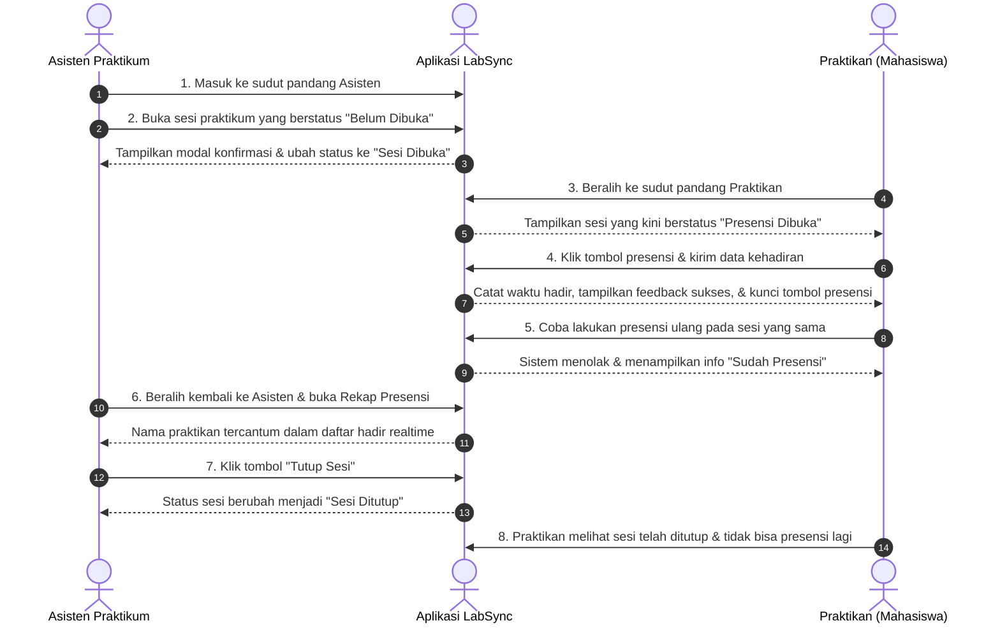

# Software Requirements Specification (SRS)
## Proyek: LabSync - Sistem Manajemen Presensi Praktikum
**Sprint 1: Antarmuka dan Alur Praktikum (2 Sudut Pandang)**  
**Peran Dokumen:** Project Management & Developer Specification  
**Versi:** 1.0.0  
**Target Platform:** Mobile App (React Native / Expo) - Responsif  

---

## 1. Pendahuluan

### 1.1 Tujuan Dokumen
Dokumen ini disusun oleh Project Manager untuk memberikan spesifikasi kebutuhan perangkat lunak (SRS) yang jelas, terstruktur, dan siap dieksekusi oleh tim programmer pada **Sprint 1**. Dokumen ini menjadi acuan tunggal (*single source of truth*) dalam pengembangan kode dan pengujian (*acceptance testing*).

### 1.2 Ruang Lingkup Sprint 1
Membangun antarmuka (*user interface*), navigasi, dan interaksi yang dapat mendemonstrasikan alur lengkap presensi praktikum dari **2 sudut pandang**:
1. **Asisten Praktikum (Asprak)**: Memantau jadwal, membuka sesi, melihat rekap kehadiran praktikan secara langsung, dan menutup sesi.
2. **Praktikan (Mahasiswa)**: Melihat jadwal dan detail sesi, melakukan presensi mandiri saat sesi dibuka, menerima umpan balik berhasil, serta melihat riwayat kehadiran pribadi.

### 1.3 Batasan Teknis & Asumsi
- **Belum Ada Database Eksternal**: Pengelolaan data menggunakan *state management* lokal (*in-memory* atau React Context / local storage) selama aplikasi berjalan.
- **Sinkronisasi Data**: Data absen tidak perlu tersinkronisasi antar-perangkat secara jaringan; cukup dikelola dalam satu aplikasi berjalan melalui pergantian peran (*role switcher*).
- **Tata Letak**: Wajib menerapkan **Flexbox** agar tampilan responsif, proporsional, dan benar di berbagai ukuran layar.

---

## 2. Karakteristik Pengguna (User Persona)

| Peran | Deskripsi | Kebutuhan Utama |
| :--- | :--- | :--- |
| **Asisten Praktikum** | Mahasiswa/asisten lab yang mengawal jalannya praktikum | Memulai sesi praktikum, memantau kehadiran mahasiswa di lab, dan mengakhiri sesi. |
| **Praktikan** | Mahasiswa peserta praktikum laboratorium | Melakukan pencatatan kehadiran saat praktikum berlangsung dan memantau status presensinya. |

---

## 3. Spesifikasi Kebutuhan Fungsional (Functional Requirements)

### SRS-F01: Jadwal dan Informasi Detail Sesi
- **Deskripsi**: Sistem harus dapat menampilkan daftar jadwal praktikum beserta informasi detailnya.
- **Detail Atribut Sesi**:
  - Nama Praktikum (contoh: *Pemrograman Perangkat Bergerak*)
  - Kode Sesi / Modul (contoh: *Modul 04 - Flexbox & State Management*)
  - Kelas (contoh: *IF-45-02*)
  - Waktu Pelaksanaan (contoh: *Rabu, 13:30 - 16:30 WIB*)
  - Ruangan Laboratorium (contoh: *Lab Komputasi Bergerak A-304*)
  - Nama Asisten Penanggung Jawab
  - Status Sesi: `Belum Dibuka` (*PENDING*), `Sesi Dibuka` (*ACTIVE*), atau `Sesi Ditutup` (*CLOSED*).
- **Kriteria Keberterimaan (Acceptance Criteria)**:
  - Pengguna dapat melihat daftar kartu sesi praktikum dengan informasi di atas secara jelas.
  - Setiap sesi memiliki indikator visual status (badge warna) yang mudah dibedakan.

---

### SRS-F02: Pengelolaan Sesi oleh Asisten (Buka & Tutup Sesi)
- **Deskripsi**: Asisten praktikum memiliki otoritas untuk mengubah status sesi praktikum.
- **Alur Kerja**:
  1. Asisten memilih sesi yang masih berstatus `Belum Dibuka`.
  2. Asisten menekan tombol aksi untuk membuka sesi.
  3. Sistem menampilkan dialog konfirmasi (**Modal / Bottom Sheet**).
  4. Setelah dikonfirmasi, status sesi berubah menjadi `Sesi Dibuka` (*ACTIVE*) dan waktu pembukaan sesi dicatat.
  5. Ketika praktikum selesai, asisten menekan tombol untuk menutup sesi melalui konfirmasi modal.
  6. Status sesi berubah menjadi `Sesi Ditutup` (*CLOSED*) dan waktu penutupan dicatat.
- **Kriteria Keberterimaan**:
  - Perubahan status sesi langsung tercermin pada antarmuka aplikasi secara *real-time*.
  - Sesi yang sudah ditutup tidak dapat dibuka kembali secara sembarangan.

---

### SRS-F03: Pencatatan Presensi Mandiri oleh Praktikan
- **Deskripsi**: Praktikan dapat melakukan presensi mandiri saat sesi praktikum dibuka.
- **Alur Kerja**:
  1. Praktikan membuka jadwal sesi praktikum.
  2. Tombol presensi hanya aktif dan dapat diklik apabila sesi berstatus `Sesi Dibuka` (*ACTIVE*).
  3. Praktikan menekan tombol presensi, menampilkan **Formulir Presensi** (bisa berupa Modal/Bottom Sheet) berisi:
     - Nama & NIM Praktikan (terisi otomatis / terdeteksi dari identitas pengguna aktif).
     - Input opsional: Posisi/Meja Lab (contoh: *Meja A-12*).
  4. Praktikan menekan tombol simpan/kirim presensi.
  5. Sistem mencatat jam kehadiran otomatis (format: `HH:mm WIB`).
  6. Sistem memberikan umpan balik (*feedback*) visual yang jelas bahwa presensi berhasil (misalnya Banner Toast atau Modal Notifikasi Sukses).
- **Kriteria Keberterimaan**:
  - Praktikan mendapatkan konfirmasi visual yang meyakinkan setelah berhasil melakukan presensi.
  - Waktu presensi yang tercatat sesuai dengan waktu tindakan dilakukan.

---

### SRS-F04: Validasi Presensi & Pencegahan Duplikasi (Anti-Double Attendance)
- **Deskripsi**: Sistem wajib mencegah satu praktikan melakukan presensi lebih dari satu kali pada sesi yang sama.
- **Kriteria Keberterimaan**:
  - Jika seorang praktikan sudah tercatat hadir pada suatu sesi, antarmuka sesi tersebut langsung berubah statusnya menjadi `Sudah Presensi` (*Attended*).
  - Tombol aksi presensi dinonaktifkan (*disabled*) atau digantikan informasi bahwa presensi telah tercatat beserta jam kehadirannya.
  - Sistem menolak upaya pengiriman presensi ganda dari identitas mahasiswa yang sama.

---

### SRS-F05: Rekapitulasi Kehadiran Realtime (Sudut Pandang Asisten)
- **Deskripsi**: Asisten praktikum dapat melihat rekapitulasi kehadiran mahasiswa yang sudah melakukan presensi pada suatu sesi.
- **Konten Rekap**:
  - Total mahasiswa hadir vs total kapasitas kelas.
  - Persentase tingkat kehadiran (*attendance rate*).
  - Daftar nama mahasiswa yang telah presensi beserta NIM, jam kehadiran, dan catatan meja.
  - Tampilan ketika daftar masih kosong (*Empty State*): "Belum ada praktikan yang melakukan presensi".
- **Kriteria Keberterimaan**:
  - Rekap dapat dibuka melalui tombol pada kartu sesi asisten (Modal atau Layar Rekap).
  - Data pada rekap bertambah otomatis saat praktikan melakukan presensi.

---

### SRS-F06: Catatan Kehadiran Pribadi (Sudut Pandang Praktikan)
- **Deskripsi**: Praktikan dapat melihat riwayat presensi yang telah dilakukannya sendiri.
- **Kriteria Keberterimaan**:
  - Terdapat tab atau layar khusus "Riwayat Presensi".
  - Menampilkan daftar praktikum yang telah dihadiri oleh praktikan tersebut beserta waktu kehadirannya.
  - Menampilkan *empty state* jika praktikan belum pernah melakukan presensi.

---

### SRS-F07: Simulasi Pengguna & Peralihan Peran (Role Switcher)
- **Deskripsi**: Memfasilitasi demonstrasi Sprint 1 tanpa sistem login/otentikasi server yang rumit.
- **Kriteria Keberterimaan**:
  - Terdapat komponen *Role Switcher* di bagian atas (Header) untuk berganti antara:
    - Mode Asisten Praktikum
    - Mode Praktikan
  - Terdapat pilihan identitas pengguna (*dummy user selector*) untuk mengganti akun praktikan/asisten yang sedang aktif, guna mendemonstrasikan skenario mahasiswa berbeda.

---

## 4. Kebutuhan Non-Fungsional (Non-Functional Requirements)

### SRS-NF01: Desain Tata Letak & Flexbox (Responsiveness)
- Wajib menggunakan **Flexbox** murni React Native (`flex`, `flexDirection`, `justifyContent`, `alignItems`, `flexWrap`).
- Tampilan harus proporsional dan tidak terjadi teks terpotong (*text clipping*) atau komponen bertumpuk (*layout overlapping*) baik di layar kecil (ponsel) maupun layar besar/web preview.

### SRS-NF02: Umpan Balik Antarmuka (Feedback & Micro-Interactions)
- Setiap tindakan pengguna (buka sesi, tutup sesi, simpan presensi) harus memiliki umpan balik langsung (Toast, Alert, atau status visual instan).
- Menggunakan komponen **Modal** atau **Bottom Sheet** untuk interaksi kritis (konfirmasi dan input data).

### SRS-NF03: Penanganan Kondisi Khusus (Edge Cases & Empty States)
- Ketika daftar sesi atau daftar presensi kosong, tampilkan pesan informatif yang ramah (*Empty State*).
- Tombol aksi pada sesi yang belum dibuka atau sudah ditutup harus dalam keadaan nonaktif (*disabled*) disertai keterangan yang jelas bagi pengguna.

---

## 5. Pembagian Tugas Programmer (Developer Assignment)

Untuk memastikan pengerjaan Sprint 1 berjalan terstruktur dan paralel tanpa saling tumpang tindih (*blocking*), tanggung jawab pengembangan dibagi kepada 3 rekan programmer:

### 👤 1. ADELIA CLEARESTA (PIC: Modul Praktikan & Presensi Mandiri)
**Tanggung Jawab Utama**: Mengembangkan seluruh antarmuka dan alur interaksi dari sudut pandang mahasiswa/praktikan.
- **Tugas 1 (Tampilan Jadwal Praktikan - `StudentView`)**:
  - Membangun halaman jadwal sesi praktikum yang disesuaikan dengan kelas mahasiswa.
  - Menampilkan informasi modul, kelas, ruangan, waktu, asisten pengampu, dan status sesi (`Belum Dibuka`, `Sesi Dibuka`, `Sesi Ditutup`).
  - Mengatur kondisi tombol presensi: dinonaktifkan jika sesi belum dibuka atau sudah ditutup.
- **Tugas 2 (Formulir Presensi Mahasiswa - `AttendanceModal` / Bottom Sheet)**:
  - Membuat modal/bottom sheet input presensi yang memuat informasi mahasiswa (NIM & Nama terisi otomatis) dan detail sesi.
  - Menambahkan input opsional nomor meja laboratorium (contoh: *Meja Lab A-12*).
  - Mengintegrasikan tombol simpan presensi yang memicu pencatatan waktu kehadiran ke state.
- **Tugas 3 (Validasi Anti-Duplikasi Presensi)**:
  - Menerapkan validasi agar mahasiswa tidak dapat melakukan presensi dua kali pada sesi yang sama.
  - Mengubah tampilan kartu sesi mahasiswa yang sudah hadir menjadi warna hijau (`✓ Sudah Presensi`) beserta catatan jam hadir, serta mengunci tombol presensi.
- **Tugas 4 (Riwayat Catatan Kehadiran Pribadi)**:
  - Membangun tab/layar "Riwayat Presensi" yang menampilkan riwayat seluruh sesi yang telah dihadiri oleh mahasiswa yang bersangkutan.
  - Menampilkan komponen *Empty State* apabila mahasiswa belum memiliki catatan kehadiran.

---

### 👤 2. ARON SORIMUDA JOHANES PASARIBU (PIC: State Architecture & Shell Navigasi)
**Tanggung Jawab Utama**: Membangun fondasi state management lokal, data mock, arsitektur shell, dan navigasi peran.
- **Tugas 1 (Data Model & Mock Data - `mockData.js`)**:
  - Menyusun struktur data awal (*dummy data*) yang mencakup daftar Asisten, Praktikan (Mahasiswa), Sesi Praktikum, dan catatan awal kehadiran.
  - Memastikan variasi status awal sesi (ada yang `PENDING`, `ACTIVE`, dan `CLOSED`) untuk keperluan demo.
- **Tugas 2 (Central State Store - `AppContext.js`)**:
  - Mengembangkan state terpusat (*in-memory*) menggunakan React Context API.
  - Mengelola state: `currentRole`, `sessions`, `attendanceList`, `currentAssistant`, dan `currentStudent`.
  - Mengimplementasikan fungsi mutasi inti:
    - `openSession(sessionId)`: mengubah status ke `ACTIVE` dan mencatat waktu buka.
    - `closeSession(sessionId)`: mengubah status ke `CLOSED` dan mencatat waktu tutup.
    - `recordAttendance(sessionId, student, notes)`: validasi status & anti-duplikasi, lalu menambahkan data presensi.
    - `hasStudentAttended(sessionId, studentId)`: helper validasi kehadiran praktikan.
    - `resetDemoData()`: mereset state kembali ke kondisi semula.
- **Tugas 3 (App Shell & Role Switcher - `Header.js`)**:
  - Membangun app bar / header dengan brand LabSync (Sprint 1).
  - Membuat kontrol **Segmented Switcher** untuk beralih instan antara **Sudut Pandang Asisten** dan **Sudut Pandang Praktikan**.
  - Membuat modal pemilih akun (*Persona Selector*) untuk mengganti identitas asisten/mahasiswa aktif saat simulasi demo.
- **Tugas 4 (Global Notification System - `FeedbackToast`)**:
  - Membuat banner notifikasi toast yang otomatis muncul saat presensi berhasil, sesi dibuka, atau sesi ditutup.

---

### 👤 3. WIPIN SAPUTRA POH (PIC: Modul Asisten & Rekap Kehadiran)
**Tanggung Jawab Utama**: Mengembangkan antarmuka dan alur kontrol dari sudut pandang asisten praktikum serta rekapitulasi data.
- **Tugas 1 (Dashboard Asisten - `AssistantView`)**:
  - Membangun tampilan daftar sesi praktikum untuk asisten beserta kartu metrik ringkasan (*Total Sesi Aktif*, *Total Hadir*, *Sesi Selesai*).
  - Menampilkan progress bar kehadiran praktikan (*X dari Y Mahasiswa Hadir*) pada setiap kartu sesi.
- **Tugas 2 (Kontrol Buka & Tutup Sesi - `SessionControlModal`)**:
  - Mengembangkan modal/dialog konfirmasi ketika asisten hendak membuka sesi praktikum.
  - Mengembangkan modal/dialog konfirmasi penutupan sesi dengan ringkasan jumlah kehadiran akhir sebelum sesi dikunci.
  - Memastikan perubahan status sesi langsung bereaksi pada antarmuka.
- **Tugas 3 (Rekapitulasi Kehadiran Realtime - `AttendanceSummaryModal`)**:
  - Membangun modal/layar rekap presensi per sesi yang menampilkan daftar mahasiswa yang hadir (NIM, Nama, Jam Hadir, Posisi Meja).
  - Menghitung dan menampilkan persentase tingkat kehadiran kelas secara otomatis.
  - Menampilkan *Empty State* informatif jika belum ada praktikan yang presensi pada sesi yang sedang dibuka.
- **Tugas 4 (Design Tokens & Komponen Pendukung - `EmptyState.js`, `StatCard.js`, `theme.js`)**:
  - Menyiapkan token desain (palet warna, tipografi, radius, shadow) dan komponen *EmptyState* reusable untuk seluruh modul.
  - Memastikan styling antarmuka asisten responsif berbasis Flexbox di perangkat mobile maupun layar web.

---

## 6. Skenario Uji Penerimaan Demo (Acceptance Test Scenario)

Programmer dinyatakan selesai mengerjakan Sprint 1 apabila alur pengujian berikut lolos secara penuh:

